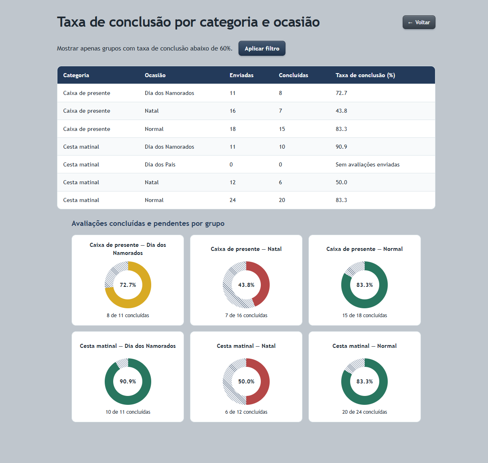
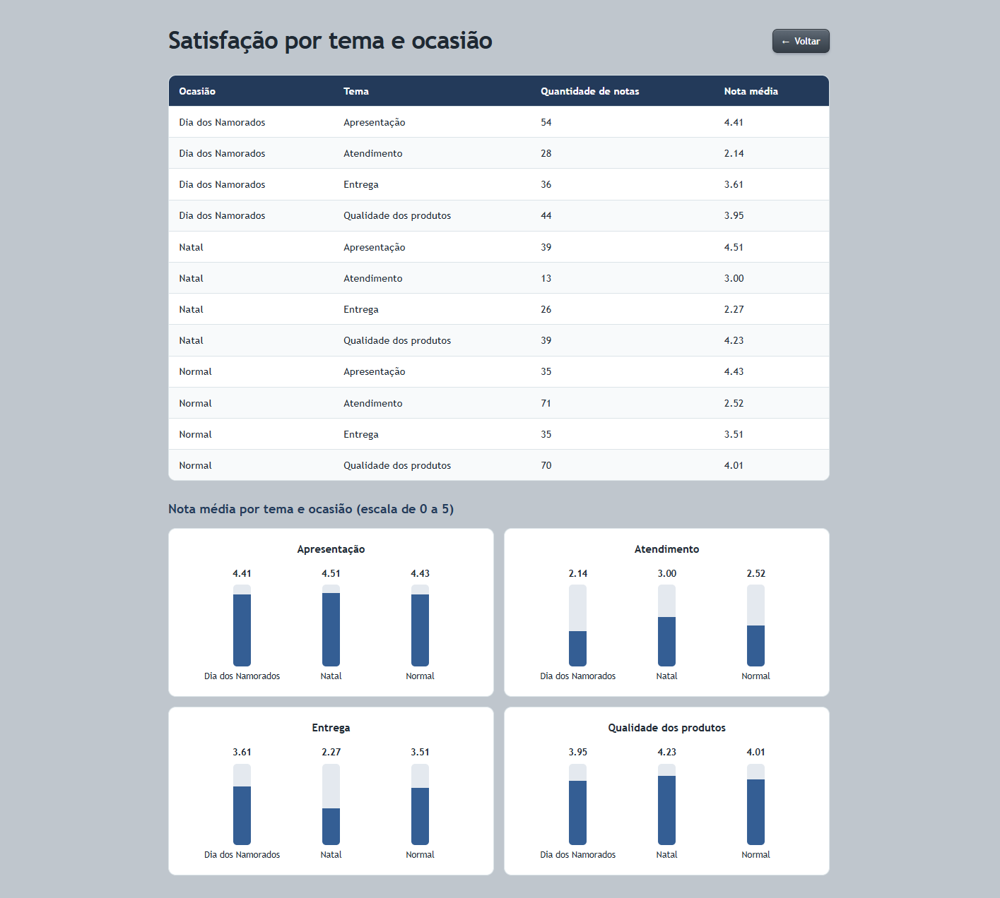
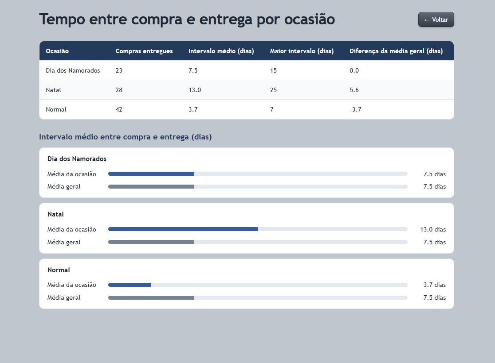

# Pesquisa de satisfação pós-compra para uma empresa de cestas e presentes

## Integrantes

- Rodrigo Henrique Hatumura Capello

## Natureza e particularidade

O projeto é uma pesquisa de satisfação pós-compra para uma empresa de cestas matinais e caixas de presente. As questões de escala recebem notas de 1 a 5 (1 sendo muito ruim e 5 muito bom) e são agrupadas por tema: atendimento, entrega, apresentação, qualidade dos produtos e outro. A pesquisa também inclui algumas questões de texto livre.
O questionário é escolhido de acordo com a categoria da compra, cestas ou caixas de presente, e ocasião, Normal, Natal ou Dia dos Namorados.

## Como rodar o sistema

**Pré-requisitos** — JDK 21 ou superior, Maven e PostgreSQL 18.

1. Clone o repositório e abra a pasta do projeto.
2. Crie um banco de dados vazio no PostgreSQL.
3. No banco vazio, execute [`schema.sql`](database/schema.sql) para criar as tabelas.
4. Em seguida, execute [`carga.sql`](database/carga.sql) para inserir os dados de teste.
5. Abra o PowerShell na raiz do projeto. Substitua `NOME_DO_BANCO` pelo nome do banco criado e `USUARIO` pelo seu usuário.
   Execute os comandos abaixo no mesmo terminal.

   ```powershell
   $env:DB_URL = "jdbc:postgresql://localhost:5432/NOME_DO_BANCO"
   $env:DB_USUARIO = "USUARIO"
   $env:DB_SENHA = Read-Host "Senha do PostgreSQL"
   mvn spring-boot:run
   ```

6. Com a aplicação rodando, abra a [página inicial](http://localhost:8080/).

## Relatórios

### Taxa de conclusão por categoria e ocasião

**Objetivo** — Comparar quantas avaliações foram enviadas e concluídas em cada combinação de categoria e ocasião. A tabela mostra as contagens e a taxa de conclusão, e os gráficos de rosca mostram a proporção de avaliações concluídas e pendentes. O filtro permite exibir apenas os grupos com taxa de conclusão abaixo de 60%.
A empresa pode usar o relatório para identificar em quais categorias e ocasiões vale incentivar mais os clientes a responder à pesquisa.



```sql
SELECT
    q.categoria,
    q.ocasiao,
    COUNT(a.codigo_avaliacao) AS enviadas,
    COUNT(a.data_conclusao) AS concluidas,
    ROUND(
        100.0 * COUNT(a.data_conclusao) / NULLIF(COUNT(a.codigo_avaliacao), 0),
        1
    ) AS percentual
FROM questionario q
LEFT JOIN avaliacao a ON a.id_questionario = q.id_questionario
GROUP BY q.categoria, q.ocasiao
-- HAVING 100.0 * COUNT(a.data_conclusao) < 60 * COUNT(a.codigo_avaliacao)
ORDER BY q.categoria, q.ocasiao;
```


- `LEFT JOIN` associa a tabela questionario à avaliacao. Foi escolhido para incluir questionários que não tivessem avaliação, apesar de que com a carga usada não foi realmente necessário.
- `GROUP BY` agrupa as avaliações por categoria e ocasião.
- `COUNT` conta as avaliações enviadas e as concluídas em cada grupo. Para as concluídas, entram apenas as que tem datas de conclusão preenchidas.
- `HAVING` filtra os grupos com taxa de conclusão abaixo de 60%. É aplicado depois do `GROUP BY` para funcionar com as contagens de cada grupo.
- `ORDER BY` ordena o resultado primeiro por categoria, e depois por ocasião.
- `NULLIF` transforma o total de avaliações enviadas em `NULL` quando ele é zero para evitar erros por conta de divisão por zero.

No pgAdmin, comente/descomente a linha do `HAVING` para testar o filtro. Na aplicação, o
botão **Aplicar/Remover filtro** controla essa condição por meio de um parâmetro JDBC.


### Satisfação por tema e ocasião

**Objetivo** — Comparar as notas médias das questões de escala de cada tema entre as ocasiões: Normal, Natal e Dia dos Namorados. A tabela mostra a média e a quantidade de notas usadas no cálculo. O gráfico coloca lado a lado as médias das ocasiões para cada tema.
A empresa pode usar o relatório para identificar quais pontos da experiência dos clientes precisam de mais atenção e em quais ocasiões priorizar melhorias.



```sql
SELECT
    qr.ocasiao,
    t.nome AS tema,
    COUNT(r.nota) AS quantidade_notas,
    ROUND(AVG(r.nota), 2) AS nota_media
FROM resposta r
JOIN questao q ON q.id_questao = r.id_questao
JOIN tema t ON t.id_tema = q.id_tema
JOIN avaliacao a ON a.codigo_avaliacao = r.codigo_avaliacao
JOIN questionario qr ON qr.id_questionario = a.id_questionario
WHERE r.nota IS NOT NULL
GROUP BY t.id_tema, t.nome, qr.ocasiao
ORDER BY qr.ocasiao, t.nome;
```


- `JOIN` liga cada resposta à questão e ao tema dela, e à avaliação e ao questionário de onde vem a ocasião.
- `WHERE` mantém apenas as respostas que têm nota.
- `GROUP BY` agrupa as notas por tema e ocasião.
- `COUNT` conta quantas notas entraram no cálculo de cada grupo.
- `AVG` calcula a nota média de cada grupo.
- `ROUND` arredonda a média para duas casas decimais.
- `ORDER BY` ordena os resultados primeiro por ocasião e, dentro de cada ocasião, por tema.

### Tempo entre compra e entrega por ocasião

**Objetivo** — Comparar o intervalo entre a compra e a entrega nas ocasiões Normal, Natal e Dia dos Namorados. A tabela mostra a quantidade de compras entregues, o intervalo médio, o maior intervalo e a diferença em relação à média geral. Para cada ocasião, o gráfico coloca a média da ocasião e a média geral em barras alinhadas.
A empresa pode usar essa comparação para identificar em quais ocasiões os pedidos costumam ser feitos com mais antecedência e planejar quando começar a receber encomendas e organizar a produção ou até aumentar estoque em períodos que os pedidos são feitos muito em cima da hora.



```sql
SELECT
    c.ocasiao,
    COUNT(*) AS compras_entregues,
    ROUND(AVG(c.data_entrega - c.data_compra), 1) AS intervalo_medio_dias,
    MAX(c.data_entrega - c.data_compra) AS maior_intervalo_dias,
    ROUND(AVG(c.data_entrega - c.data_compra) - geral.media, 1)
        AS diferenca_da_media_geral_dias,
    ROUND(geral.media, 1) AS media_geral_dias
FROM compra c
CROSS JOIN (
    SELECT AVG(data_entrega - data_compra) AS media
    FROM compra
    WHERE data_entrega IS NOT NULL
) AS geral
WHERE c.data_entrega IS NOT NULL
GROUP BY c.ocasiao, geral.media
ORDER BY c.ocasiao;
```


- `WHERE` seleciona apenas as compras com data de entrega preenchida.
- `GROUP BY` agrupa as compras por ocasião. A média geral também aparece porque é usada no `SELECT` e tem o mesmo valor em todos os grupos.
- `COUNT` conta as compras entregues em cada ocasião.
- `AVG` calcula a média dos intervalos entre compra e entrega.
- `MAX` encontra o maior intervalo em cada ocasião (Normal, Natal ou Dia dos Namorados)
- A subconsulta calcula a média geral com todas as compras entregues.
- `CROSS JOIN` associa essa média geral a todas as compras da consulta principal, permitindo compará-la com a média de cada ocasião.
- `ROUND` arredonda as médias e a diferença para uma casa decimal.
- `ORDER BY` ordena os resultados por ocasião.